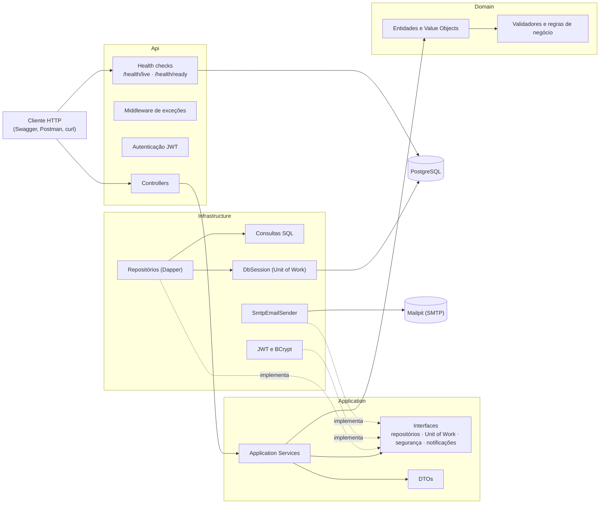
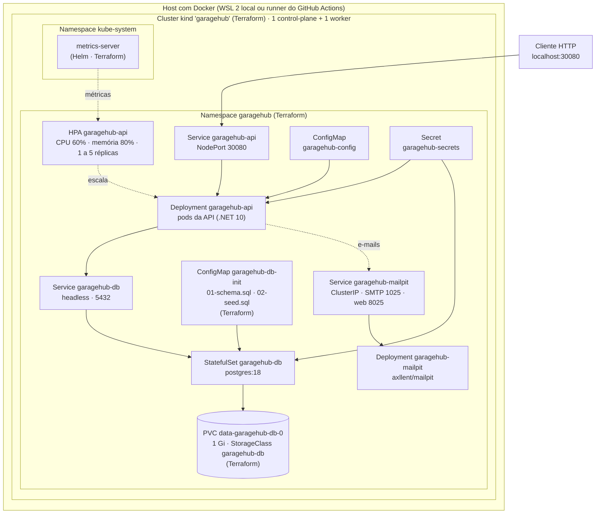
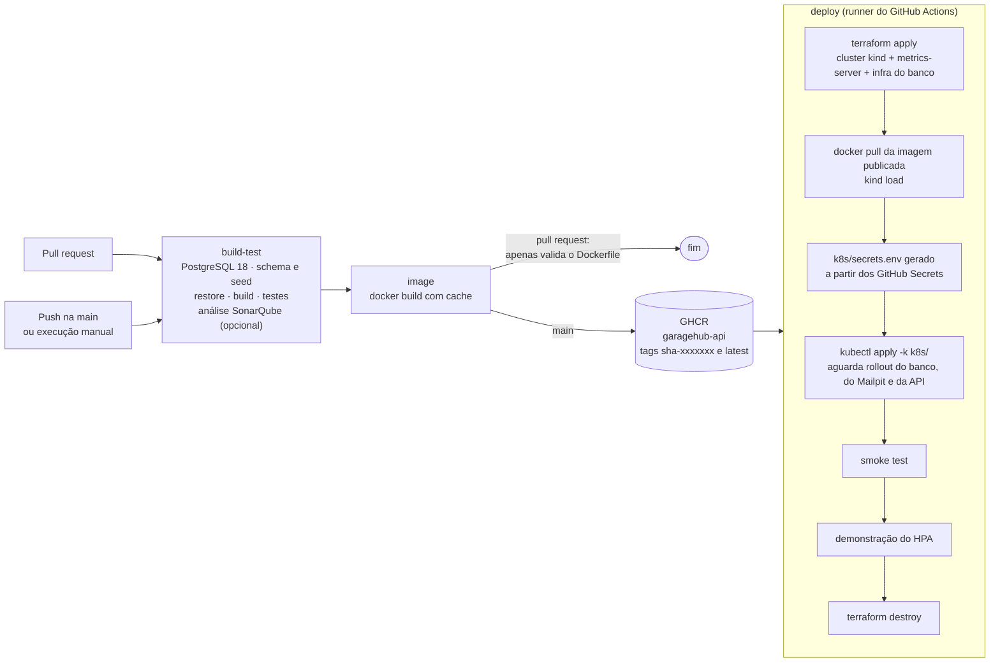

# GarageHub


[](https://github.com/beatavernaro/GarageHub/actions/workflows/ci-cd.yml)


GarageHub é um MVP de back-end para gestão de oficinas mecânicas, desenvolvido como parte do Tech Challenge da Pós Tech em Software Architecture da FIAP.

O sistema foi criado para centralizar e organizar processos que normalmente poderiam depender de anotações manuais ou planilhas, como cadastro de clientes e veículos, controle de peças e insumos, elaboração de orçamentos e acompanhamento da execução dos serviços.

O objetivo principal do projeto é oferecer uma base estruturada para o gerenciamento do fluxo de atendimento da oficina, desde a identificação do cliente e do veículo até a aprovação do orçamento, geração da ordem de serviço, execução dos serviços e entrega do veículo.

> ⚠️**Projeto exclusivamente acadêmico**⚠️
>
> As credenciais e senhas presentes neste repositório foram disponibilizadas exclusivamente para facilitar a execução e avaliação deste projeto acadêmico.
>
> Em um ambiente de produção, informações sensíveis **não devem ser armazenadas ou expostas diretamente no código-fonte ou no repositório**. Credenciais, senhas, chaves e outros secrets devem ser armazenados de forma segura, utilizando variáveis de ambiente ou serviços apropriados de gerenciamento de secrets.

## 📑Sumário

- [Como executar o projeto](#-como-executar-o-projeto)
- [Autenticação e acesso à API](#-autenticação-e-acesso-à-api)
- [Funcionalidades e fluxos de negócio](#-funcionalidades-e-fluxos-de-negócio)
- [Notificações por e-mail (Mailpit)](#-notificações-por-e-mail-mailpit)
- [Arquitetura e Domain-Driven Design](#️-arquitetura-e-domain-driven-design)
- [Estrutura do projeto](#-estrutura-do-projeto)
- [Banco de dados e persistência](#️-banco-de-dados-e-persistência)
- [Tecnologias utilizadas](#️-tecnologias-utilizadas)
- [API REST e documentação](#-api-rest-e-documentação)
- [Segurança e validações](#️-segurança-e-validações)
- [Docker](#-docker)
- [Arquitetura da infraestrutura](#-arquitetura-da-infraestrutura)
- [Infraestrutura com Terraform](#-infraestrutura-com-terraform)
- [Kubernetes](#-kubernetes)
- [Escalabilidade automática (HPA)](#-escalabilidade-automática-hpa)
- [Testes e cobertura](#-testes-e-cobertura)
- [Qualidade de código e SonarQube](#-qualidade-de-código-e-sonarqube)
- [CI/CD com GitHub Actions](#-cicd-com-github-actions)
- [Solução de problemas](#-solução-de-problemas)
- [Decisões técnicas, premissas e limitações do MVP](#-decisões-técnicas-premissas-e-limitações-do-mvp)
- [Autora](#-autora)

## Principais funcionalidades

- Cadastro e gerenciamento de clientes
- Cadastro e gerenciamento de veículos
- Cadastro e gerenciamento de serviços
- Cadastro de peças e insumos
- Controle de estoque
- Criação e gerenciamento de orçamentos
- Inclusão de serviços, peças e insumos no orçamento
- Aprovação, rejeição, cancelamento e expiração de orçamentos
- Geração automática da Ordem de Serviço após a aprovação do orçamento
- Abertura direta da Ordem de Serviço informando cliente, veículo, serviços e peças
- Controle do status dos serviços executados
- Atualização automática do status da Ordem de Serviço
- Consulta do andamento da Ordem de Serviço
- Monitoramento do tempo médio de execução dos serviços
- Autenticação administrativa utilizando JWT
- Validação de CPF, CNPJ e placa de veículos
- Documentação REST por meio de Swagger/OpenAPI
- Testes unitários e de integração
- Análise estática de código e segurança com SonarQube Cloud
- Health checks de liveness e readiness
- Execução em Kubernetes com escalabilidade automática (HPA)
- Infraestrutura local provisionada com Terraform
- Pipeline de CI/CD com publicação da imagem e deploy automatizado

## Objetivos técnicos

Além das funcionalidades de negócio, o projeto busca aplicar conceitos e práticas relacionados a:

- Domain-Driven Design (DDD)
- Clean Architecture
- Separação de responsabilidades
- Regras de domínio centralizadas
- APIs RESTful
- Persistência utilizando PostgreSQL e Dapper
- Autenticação e autorização
- Testes automatizados
- Conteinerização com Docker
- Integração contínua com GitHub Actions
- Qualidade e segurança de código

### Objetivos da Fase 2

A Fase 2 evolui o MVP para um ambiente com orquestração, infraestrutura como código e entrega contínua:

- Execução da API e do PostgreSQL em **Kubernetes**, com Deployment, StatefulSet, Services, ConfigMaps e Secrets;
- **Escalabilidade automática** da API com HorizontalPodAutoscaler (HPA) baseado em CPU e memória;
- Provisionamento do cluster Kubernetes local e da infraestrutura do banco de dados com **Terraform**;
- Pipeline de **CI/CD** com build, testes, publicação da imagem Docker e deploy automatizado no Kubernetes;
- Health checks para as probes de liveness e readiness do Kubernetes;
- Gestão de secrets sem credenciais versionadas no repositório.

## 🚀 Como executar o projeto

O GarageHub pode ser executado de duas formas:

| Ambiente | Indicado para | Endereço da API |
| --- | --- | --- |
| **Docker Compose** | Desenvolvimento local e execução rápida | `http://localhost:8080` |
| **Kubernetes local** (kind + Terraform) | Demonstração da Fase 2: orquestração, HPA e deploy | `http://localhost:30080` |

Os dois ambientes podem ser executados ao mesmo tempo, pois utilizam portas diferentes.

### Opção 1: Docker Compose

A aplicação, o banco de dados PostgreSQL e o Mailpit são executados em containers, e os scripts de criação e carga inicial do banco são executados automaticamente.

#### Pré-requisitos

- Git
- Docker
- Docker Compose

Não é necessário instalar localmente o .NET ou o PostgreSQL para executar a aplicação utilizando Docker.

#### 1. Clonar o repositório

```bash
git clone https://github.com/beatavernaro/GarageHub.git
cd GarageHub
```

#### 2. Configurar as variáveis de ambiente (opcional)

O `docker-compose.yml` lê a senha do banco e a chave JWT de um arquivo `.env`, que não é versionado. Sem esse arquivo, são utilizados valores padrão de desenvolvimento e o ambiente sobe sem nenhuma configuração adicional.

Para definir valores próprios:

```bash
cp .env.example .env
```

#### 3. Subir o ambiente

```bash
docker compose up --build
```

O Docker Compose será responsável por:

- Construir a imagem da API;
- Inicializar o PostgreSQL;
- Criar o banco de dados;
- Executar os scripts de criação das tabelas;
- Executar os dados iniciais (seed);
- Aguardar o banco ficar pronto (healthcheck) antes de iniciar a API;
- Configurar a comunicação entre a API e o banco de dados;
- Iniciar o Mailpit, que recebe os e-mails de notificação enviados pela API.

#### 4. Acessar a API

```text
Swagger:    http://localhost:8080/swagger
Liveness:   http://localhost:8080/health/live
Readiness:  http://localhost:8080/health/ready
Mailpit:    http://localhost:8025   (e-mails enviados pela API)
```

#### 5. Encerrar o ambiente

Para interromper os containers mantendo os dados do PostgreSQL:

```bash
docker compose down
```

Para remover também os volumes, incluindo os dados armazenados:

```bash
docker compose down -v
```

### Opção 2: Kubernetes local

Execute no terminal do WSL (ou em Linux/macOS), a partir da raiz do repositório. Os pré-requisitos e cada etapa estão detalhados em [Infraestrutura com Terraform](#-infraestrutura-com-terraform) e [Kubernetes](#-kubernetes).

```bash
# 1. Provisionar o cluster kind e a infraestrutura do banco
terraform -chdir=infra init
terraform -chdir=infra apply

# 2. Criar o arquivo de secrets (não versionado) e definir valores próprios
cp k8s/secrets.env.example k8s/secrets.env

# 3. Build da imagem e deploy da API, do PostgreSQL e do Mailpit
bash scripts/deploy-local.sh

# 4. Verificar a aplicação
bash scripts/smoke-test.sh

# 5. (Opcional) Demonstrar o escalonamento automático
bash scripts/load-test.sh

# 6. (Opcional) Demonstrar as notificações por e-mail
kubectl -n garagehub port-forward svc/garagehub-mailpit 8025:8025   # em outro terminal
bash scripts/demo-notificacao.sh
```

A API fica disponível em `http://localhost:30080/swagger` e, com o port-forward ativo, o Mailpit em `http://localhost:8025`.

Para remover todo o ambiente:

```bash
terraform -chdir=infra destroy
```

## 🔐 Autenticação e acesso à API

O GarageHub utiliza autenticação baseada em **JWT (JSON Web Token)** para proteger as operações administrativas da API.

Os endpoints administrativos exigem que o usuário esteja autenticado. Após o login, a API retorna um token JWT que deve ser enviado nas requisições protegidas utilizando o esquema `Bearer`.

### Login

A autenticação é realizada através do endpoint:

```http
POST /api/Auth/login
```

Para facilitar a execução e avaliação do projeto, o banco de dados é inicializado com usuários de desenvolvimento através do script de seed.

### Usuários de desenvolvimento

| Perfil | E-mail | Senha |
| --- | --- | --- |
| Administrador | `admin@garagehub.com` | `Admin@123` |
| Atendente | `atendente@garagehub.com` | `Atendente@123` |

Os dois usuários possuem o mesmo nível de acesso aos endpoints protegidos.

> As credenciais acima são destinadas exclusivamente ao ambiente acadêmico e de desenvolvimento. Em um ambiente de produção, credenciais e secrets não devem ser armazenados diretamente em arquivos versionados no repositório.

### Autenticação pelo Swagger

Para acessar os endpoints protegidos através do Swagger:

1. Acesse `http://localhost:8080/swagger`.
2. Execute o endpoint `POST /api/Auth/login` utilizando as credenciais de desenvolvimento.
3. Copie o token JWT retornado pela API.
4. Clique no botão **Authorize** disponível no Swagger.
5. Informe o token no campo de autenticação.
6. Após a autorização, os endpoints administrativos poderão ser executados normalmente.

### Proteção dos endpoints

A API diferencia operações administrativas de operações que precisam ser acessíveis pelo cliente.

As funcionalidades administrativas, como gerenciamento de clientes, veículos, serviços, estoque e ordens de serviço, são protegidas por autenticação JWT.

Operações que fazem parte da interação do cliente com a oficina podem ser disponibilizadas sem autenticação administrativa quando necessário ao fluxo de negócio, como o acompanhamento ou a resposta a um orçamento.

A configuração de autenticação também realiza a validação do token, incluindo:

- Assinatura do token;
- Emissor (`Issuer`);
- Destinatário (`Audience`);
- Tempo de validade;
- Identificação do usuário autenticado.

Essa abordagem permite manter as operações internas protegidas enquanto preserva os endpoints necessários para interação externa com o sistema.

## 🔧 Funcionalidades e fluxos de negócio

O GarageHub centraliza o fluxo de atendimento de uma oficina mecânica, desde o cadastro do cliente e do veículo até a elaboração do orçamento, execução dos serviços e conclusão da Ordem de Serviço.

### Clientes

O sistema permite o gerenciamento dos clientes da oficina, incluindo:

- Cadastro de pessoa física ou jurídica;
- Identificação por CPF ou CNPJ;
- Consulta por identificador ou documento;
- Atualização dos dados cadastrais;
- Inativação de clientes;
- Registro de informações de contato e endereço.

### Veículos

Os veículos são vinculados aos seus respectivos clientes e possuem as informações necessárias para identificação e acompanhamento dos atendimentos.

O sistema permite:

- Cadastro de veículos;
- Associação do veículo ao cliente;
- Identificação por placa;
- Registro de marca, modelo, ano, cor, chassi e quilometragem;
- Atualização dos dados do veículo;
- Inativação de veículos;
- Consulta dos veículos cadastrados.

### Serviços

Os serviços representam os trabalhos que podem ser executados pela oficina.

Entre as funcionalidades disponíveis estão:

- Cadastro e atualização de serviços;
- Definição e alteração de preço;
- Ativação e inativação;
- Consulta dos serviços disponíveis;
- Acompanhamento do tempo médio de execução.

### Peças, insumos e estoque

O sistema possui controle dos itens utilizados durante a execução dos serviços, diferenciando peças e insumos.

A gestão de estoque contempla:

- Cadastro de peças e insumos;
- Código interno para identificação;
- Definição e alteração de preço;
- Controle da quantidade disponível;
- Entrada manual de estoque;
- Saída manual de estoque;
- Ativação e inativação de itens;
- Validação para impedir estoque negativo.

### Orçamentos

O orçamento concentra os serviços, peças e insumos previstos para o atendimento do veículo.

O fluxo permite:

- Criação de orçamento para um cliente e veículo;
- Inclusão e remoção de serviços, peças e insumos;
- Alteração de quantidade e valor unitário dos itens;
- Aplicação de desconto;
- Cálculo do valor total;
- Envio do orçamento para aprovação do cliente;
- Aprovação;
- Rejeição;
- Cancelamento;
- Expiração do orçamento.

O orçamento expira **15 dias após o envio ao cliente**, caso ainda esteja aguardando a decisão. A expiração é verificada sempre que o orçamento é consultado ou recebe uma operação, de modo que um orçamento vencido passa para o status `Expirado` e não pode mais ser aprovado.

Os itens adicionados ao orçamento mantêm um **snapshot das informações relevantes**, preservando os dados utilizados naquele momento mesmo que o cadastro original seja posteriormente alterado.

### Aprovação e geração da Ordem de Serviço

Quando um orçamento é aprovado, o sistema gera automaticamente a **Ordem de Serviço (OS)** correspondente.

A Ordem de Serviço mantém as informações necessárias para execução do atendimento, incluindo cliente, veículo, serviços e valores definidos no orçamento aprovado.

Durante a aprovação, o sistema também verifica a disponibilidade dos itens de estoque necessários e informa quando existem itens com quantidade insuficiente.

A gravação da aprovação e a geração da Ordem de Serviço ocorrem na mesma transação: se a OS não puder ser gravada, a aprovação também é desfeita.

### Abertura direta da Ordem de Serviço

Para atendimentos em que o serviço já está autorizado no momento da chegada do veículo, a Ordem de Serviço pode ser aberta em uma única requisição, informando cliente, veículo, serviços e peças.

Como toda Ordem de Serviço pertence a um orçamento, o sistema gera automaticamente um orçamento já aprovado com os itens informados e, a partir dele, cria a OS. Dessa forma, as mesmas regras de domínio da aprovação são aplicadas:

- O cliente e o veículo devem existir, estar ativos e o veículo deve pertencer ao cliente;
- A OS deve possuir pelo menos um serviço;
- Serviços e itens de estoque devem existir, estar ativos e não podem ser repetidos;
- Quando o valor unitário não é informado, é utilizado o preço cadastrado do serviço ou do item de estoque;
- Os itens mantêm o snapshot de nome e descrição do momento da abertura.

O orçamento, seus itens e a Ordem de Serviço são gravados em uma única transação. A resposta retorna a identificação da OS criada, a do orçamento vinculado e, assim como na aprovação, os itens com estoque insuficiente.

### Execução dos serviços

Os serviços pertencentes à Ordem de Serviço possuem controle individual de execução.

O fluxo considera os estados:

- Aguardando execução;
- Em execução;
- Finalizado.

O sistema registra os momentos de início e finalização, permitindo posteriormente calcular o tempo gasto na execução dos serviços.

As transições de status respeitam as regras do domínio, impedindo, por exemplo, a finalização de um serviço que ainda não tenha sido iniciado.

### Acompanhamento da Ordem de Serviço

A Ordem de Serviço representa o acompanhamento do atendimento após a aprovação do orçamento.

Seu status é atualizado de acordo com a evolução do fluxo de execução, permitindo identificar o estágio atual do atendimento e consultar seu progresso através da API.

Ao final da execução de todos os serviços, a Ordem de Serviço pode ser finalizada e posteriormente marcada como entregue ao cliente.

### Monitoramento de tempo

O sistema registra informações temporais durante a execução dos serviços e das Ordens de Serviço.

Esses dados permitem consultar indicadores de tempo de execução, incluindo o **tempo médio dos serviços**, oferecendo informações que podem auxiliar a oficina no acompanhamento da eficiência operacional.

## 📧 Notificações por e-mail (Mailpit)

Sempre que o status de uma Ordem de Serviço é alterado com sucesso, o cliente recebe um e-mail com:

- a identificação da Ordem de Serviço;
- o nome do cliente;
- o novo status (Aguardando execução, Em execução, Finalizada ou Entregue).

Nos ambientes locais, os e-mails são enviados via SMTP para o **[Mailpit](https://mailpit.axllent.org/)**, que os captura e exibe em uma interface web. Nenhuma mensagem sai para a internet.

### Quando o e-mail é enviado

| Operação | Endpoint | Notifica quando |
| --- | --- | --- |
| Alterar o status de um serviço da OS | `PATCH /api/OrdensServico/{id}/servicos/{ordemServicoServicoId}/status` | O status recalculado da OS muda. Por exemplo, o primeiro serviço iniciado leva a OS para *Em execução*, e a finalização do último serviço a leva para *Finalizada* |
| Entregar a OS | `POST /api/OrdensServico/{id}/entregar` | Sempre, pois a OS passa para *Entregue* |

Se a alteração de um serviço não muda o status da OS (por exemplo, iniciar um segundo serviço com a OS já em execução), nenhum e-mail é enviado. A abertura da OS também não gera notificação, pois não é uma alteração de status.

### Funcionamento

- `IEmailSender` (`Application/Interfaces/Notifications`) é a abstração do envio. O `OrdemServicoService` monta a mensagem e a envia **depois** de persistir a alteração da OS.
- `SmtpEmailSender` (`Infrastructure/Notifications`) implementa o envio com o `SmtpClient` do próprio .NET, sem dependências adicionais.
- **Falhas não afetam a OS:** se o envio falhar (servidor SMTP indisponível, timeout, cliente sem e-mail), o erro é registrado em log e a requisição retorna sucesso normalmente.
- **Timeout curto:** o envio ocorre durante a requisição e é limitado a `Smtp:TimeoutSeconds` (5 segundos por padrão), para que uma indisponibilidade do servidor SMTP não deixe a API aguardando.
- Não há filas, mensageria nem workers. O envio é síncrono e simples, adequado ao escopo do MVP.

### Configuração

| Chave | Docker Compose | Kubernetes | Padrão (`appsettings.json`) |
| --- | --- | --- | --- |
| `Smtp__Host` | `mailpit` | `garagehub-mailpit` | `localhost` |
| `Smtp__Port` | `1025` | `1025` | `1025` |
| `Smtp__From` | — | — | `GarageHub <nao-responda@garagehub.local>` |
| `Smtp__TimeoutSeconds` | — | — | `5` |

### Demonstração

O script `scripts/demo-notificacao.sh` abre uma OS com os dados do seed, altera seu status (*Em execução* → *Finalizada* → *Entregue*) e confirma, pela API do Mailpit, que os três e-mails foram recebidos.

#### Docker Compose

```bash
docker compose up -d --build
BASE_URL=http://localhost:8080 bash scripts/demo-notificacao.sh
```

#### Kubernetes local

```bash
kubectl -n garagehub port-forward svc/garagehub-mailpit 8025:8025   # em outro terminal
bash scripts/demo-notificacao.sh
```

Saída esperada:

```text
==> E-mails recebidos no Mailpit (http://localhost:8025) para a OS a3fcf707-...
    contato@xpto.com | GarageHub - Ordem de Serviço a3fcf707-...: Em execução
    contato@xpto.com | GarageHub - Ordem de Serviço a3fcf707-...: Finalizada
    contato@xpto.com | GarageHub - Ordem de Serviço a3fcf707-...: Entregue
==> OK: 3 notificações recebidas. Veja as mensagens em http://localhost:8025
```

Depois, abra `http://localhost:8025` para ver as mensagens. O fluxo também pode ser feito manualmente pelo Swagger: abra uma OS (`POST /api/OrdensServico`), altere o status de um serviço para `EmExecucao` e confira o e-mail no Mailpit.

Para ver o comportamento em caso de falha, pare o Mailpit (`docker compose stop mailpit`) e altere o status de uma OS. A requisição continua retornando `204`, e o erro aparece em `docker logs garagehub-api`.

### Testes automatizados

| Teste | Arquivo | Verifica |
| --- | --- | --- |
| Notificação na mudança de status | `OrdemServicoServiceTests` | O e-mail é enviado ao cliente com o Id da OS, o nome do cliente e o novo status (*Em execução*) |
| Status da OS sem alteração | `OrdemServicoServiceTests` | Iniciar um segundo serviço com a OS já em execução não envia e-mail |
| Entrega da OS | `OrdemServicoServiceTests` | O e-mail é enviado com o status *Entregue* |
| Falha no envio | `OrdemServicoServiceTests` | A exceção do envio não é propagada, a OS é atualizada e o erro é registrado em log (`LogError`) |
| Cliente não encontrado | `OrdemServicoServiceTests` | Nenhum e-mail é enviado, nenhuma exceção ocorre e um aviso é registrado (`LogWarning`) |
| Timeout do SMTP | `SmtpEmailSenderTests` | Com um servidor que aceita a conexão e não responde, o envio é interrompido após o timeout configurado (1 s no teste) |
| Configuração ausente | `SmtpEmailSenderTests` | Sem `Smtp:Host`, o envio falha com mensagem clara |
| Fluxo completo via API | `FluxoOrdemServicoIntegrationTests` | Alterar o status de um serviço pelo endpoint gera a notificação. Nesse teste, o envio SMTP é substituído por um fake em memória (`FakeEmailSender`) |

### Resultado da validação

| Ambiente | Cenário | Resultado |
| --- | --- | --- |
| Testes automatizados | `dotnet test` | 369 testes aprovados e 0 falhas. Cobertura de linhas de 97,93% medida pelo Coverlet (no SonarQube Cloud, 96,7%) |
| Docker Compose | `scripts/demo-notificacao.sh` | 3 e-mails recebidos no Mailpit (*Em execução*, *Finalizada*, *Entregue*) |
| Docker Compose | Mailpit parado | Todas as requisições retornaram sucesso, a OS foi atualizada e o erro foi registrado no log da API |
| Kubernetes (kind) | `scripts/deploy-local.sh` | Rollouts de `garagehub-db`, `garagehub-mailpit` e `garagehub-api` concluídos |
| Kubernetes (kind) | `scripts/demo-notificacao.sh` via port-forward | 3 e-mails recebidos no Mailpit do cluster |

E-mail recebido no Mailpit:

```text
Assunto: GarageHub - Ordem de Serviço f0a5d844-42b6-4b0e-ae45-1c1bcd077c3d: Entregue

Olá, Cliente Fluxo OS.

O status da sua ordem de serviço foi atualizado.

Ordem de Serviço: f0a5d844-42b6-4b0e-ae45-1c1bcd077c3d
Cliente: Cliente Fluxo OS
Novo status: Entregue

GarageHub
```

Log da API com o Mailpit indisponível:

```text
fail: Application.Services.OrdemServicoService[0]
      Falha ao enviar a notificação de alteração de status da ordem de serviço 46c74bea-2548-498b-a970-9727010a8c56.
```

### Limitações

- O envio é síncrono e ocorre dentro da requisição. Com o servidor SMTP lento ou inacessível, a resposta pode demorar até o timeout configurado.
- Não há reenvio: uma notificação que falhou fica apenas registrada em log.
- O Mailpit guarda as mensagens em memória, então elas se perdem quando o container ou o pod é recriado.
- No Kubernetes, a interface do Mailpit não fica exposta fora do cluster e é acessada via `kubectl port-forward`.

## 🏗️ Arquitetura e Domain-Driven Design

O GarageHub foi desenvolvido como um **monólito modular**, utilizando princípios de **Clean Architecture** e **Domain-Driven Design (DDD)** para organizar as responsabilidades da aplicação e manter as regras de negócio independentes de detalhes de infraestrutura.

A solução está dividida em quatro projetos principais: **Domain, Application, Infrastructure e API**.

### Domain

A camada de domínio concentra as regras de negócio e os conceitos centrais do GarageHub.

Nela estão localizados:

- Entidades do domínio;
- Regras e invariantes de negócio;
- Value Objects;
- Enums relacionados aos estados do sistema;
- Exceções de domínio;
- Validações relacionadas aos objetos de negócio.

As entidades são responsáveis por proteger seu próprio estado. Operações como aprovação de orçamento, alteração de status, movimentação de estoque e execução de serviços são realizadas através de comportamentos do domínio, evitando que regras importantes fiquem espalhadas pelos controllers ou pela infraestrutura.

### Application

A camada de aplicação coordena os casos de uso do sistema e faz a comunicação entre o domínio e as abstrações necessárias para execução das operações.

Ela contém:

- Application Services;
- DTOs de entrada e saída;
- Interfaces dos serviços;
- Interfaces dos repositórios;
- Abstrações utilizadas pelos casos de uso.

Essa camada organiza fluxos como criação de clientes, elaboração e aprovação de orçamentos, geração de Ordens de Serviço e movimentação de estoque, delegando às entidades as regras que pertencem ao domínio.

### Infrastructure

A camada de infraestrutura contém as implementações relacionadas ao acesso a recursos externos e persistência dos dados.

Entre suas responsabilidades estão:

- Implementação dos repositórios;
- Acesso ao PostgreSQL;
- Execução das consultas utilizando Dapper;
- Scripts SQL;
- Criação do schema do banco;
- Seed dos dados iniciais;
- Envio de e-mails via SMTP (notificações de status da OS);
- Configuração das dependências de infraestrutura.

As abstrações dos repositórios permanecem na camada de aplicação, enquanto suas implementações ficam na infraestrutura, reduzindo o acoplamento dos casos de uso com a tecnologia de persistência.

### API

A camada de API representa o ponto de entrada HTTP da aplicação.

Ela é responsável por:

- Controllers REST;
- Configuração da aplicação;
- Autenticação e autorização JWT;
- Identificação do usuário autenticado;
- Middleware para tratamento global de exceções;
- Configuração do Swagger/OpenAPI;
- Injeção das dependências necessárias para execução da aplicação.

Os controllers permanecem responsáveis principalmente por receber as requisições e encaminhá-las para os serviços da aplicação, evitando concentrar regras de negócio na camada HTTP.

### Aplicação de Domain-Driven Design

O DDD foi utilizado para modelar o sistema a partir dos conceitos e processos existentes no domínio de uma oficina mecânica.

Entre os principais conceitos representados no modelo estão:

- Cliente;
- Veículo;
- Serviço;
- Item de Estoque;
- Orçamento;
- Ordem de Serviço;
- Aprovação e rejeição de orçamento;
- Execução de serviço;
- Movimentação de estoque;
- Entrega do veículo.

As regras relacionadas a esses conceitos são mantidas próximas às entidades responsáveis por elas, buscando evitar modelos compostos apenas por propriedades sem comportamento.

### Principais regras de domínio

Entre as regras implementadas estão:

- Um orçamento deve seguir transições de status válidas;
- A aprovação de um orçamento gera uma Ordem de Serviço;
- Orçamentos possuem controle de expiração;
- Serviços devem ser iniciados antes de serem finalizados;
- Serviços finalizados não podem retornar para estados anteriores;
- O estoque de uma peça ou insumo não pode ficar negativo;
- A disponibilidade de estoque é verificada durante o fluxo do orçamento;
- Alterações de preço não modificam os valores registrados anteriormente em orçamentos e Ordens de Serviço;
- Os itens mantêm snapshots das informações relevantes para preservar o histórico;
- A Ordem de Serviço acompanha a evolução dos serviços associados;
- Datas de início, finalização e entrega são registradas de acordo com as ações realizadas no domínio.

### Linguagem Ubíqua

O projeto utiliza uma **Linguagem Ubíqua** para manter os mesmos termos de negócio na documentação, no código e nas APIs.

Termos como `Orcamento`, `OrdemServico`, `Servico`, `ItemEstoque`, `Cliente` e `Veiculo` representam diretamente conceitos utilizados no domínio da oficina, reduzindo diferenças entre a linguagem técnica e a linguagem de negócio.

A modelagem completa do domínio, incluindo **Event Storming, agregados, eventos, comandos, políticas, diagramas e Linguagem Ubíqua**, está disponível na documentação DDD do projeto.

**Documentação DDD:**  
https://github.com/beatavernaro/GarageHub/tree/main/Documentacao/DDD

## 📁 Estrutura do projeto

A solução foi organizada de forma a separar as responsabilidades de domínio, aplicação, infraestrutura, exposição da API e testes automatizados.

A estrutura principal do GarageHub é:

```text
GarageHub/
├── .github/
│   └── workflows/           # Build, testes, análise SonarQube, imagem (GHCR) e deploy no Kubernetes
│
├── docs/                    # Especificação OpenAPI da API
├── Documentacao/            # Documentação DDD e documento de entrega
├── infra/                   # Terraform: cluster kind, metrics-server e infraestrutura do banco
├── k8s/                     # Manifestos Kubernetes (kustomize)
├── scripts/                 # Deploy local, smoke test, teste de carga e demonstração das notificações
│
├── src/
│   ├── Api/
│   ├── Application/
│   ├── Domain/
│   └── Infrastructure/
│
├── tests/
│   └── Tests/
│
├── Dockerfile
├── docker-compose.yml
├── .env.example
└── README.md
```

Os diretórios `infra/`, `k8s/` e `scripts/` são descritos em [Infraestrutura com Terraform](#-infraestrutura-com-terraform), [Kubernetes](#-kubernetes) e [Escalabilidade automática (HPA)](#-escalabilidade-automática-hpa).

### `src/Domain`

Contém o núcleo do negócio e não depende das camadas externas da aplicação.

Principais elementos:

```text
Domain/
├── Entities/
├── Enums/
├── Exceptions/
├── Helpers/
├── Validators/
└── ValueObjects/
```

Nesta camada estão entidades como `Cliente`, `Veiculo`, `Servico`, `ItemEstoque`, `Orcamento` e `OrdemServico`, juntamente com suas regras e comportamentos de domínio.

### `src/Application`

Contém os casos de uso e a coordenação das operações da aplicação.

Principais elementos:

```text
Application/
├── DTOs/
├── Interfaces/
│   ├── Notifications/
│   ├── Repositories/
│   ├── Security/
│   └── Services/
└── Services/
```

Os DTOs definem os dados utilizados na entrada e saída dos casos de uso. As interfaces estabelecem os contratos necessários para a aplicação, enquanto os Application Services coordenam os fluxos utilizando as entidades e os repositórios.

### `src/Infrastructure`

Contém as implementações relacionadas à persistência e ao acesso ao banco de dados.

Principais elementos:

```text
Infrastructure/
├── Database/
├── DependencyInjection/
├── Mappers/
├── Notifications/
├── Repositories/
├── Security/
└── SQL/
```

Os repositórios implementam os contratos definidos pela aplicação e utilizam **Dapper** para comunicação com o PostgreSQL.

As consultas SQL são mantidas separadamente dos repositórios, facilitando sua leitura e manutenção.

A pasta de banco de dados também contém os scripts responsáveis pela criação da estrutura e pelos dados iniciais utilizados no ambiente de desenvolvimento.

### `src/Api`

Representa a camada HTTP e o ponto de inicialização da aplicação.

Principais elementos:

```text
Api/
├── Controllers/
├── HealthChecks/
├── Middleware/
└── Security/
```

Os controllers disponibilizam os recursos através da API REST, enquanto os componentes de segurança são responsáveis pela integração com a autenticação JWT.

O middleware centraliza o tratamento das exceções geradas durante as requisições.

O `Program.cs` realiza a configuração da aplicação, incluindo injeção de dependências, autenticação, autorização, Swagger/OpenAPI e pipeline HTTP.

### `tests/Tests`

Concentra os testes automatizados do projeto.

Os testes são divididos entre:

- **Testes unitários**, responsáveis por validar isoladamente regras de domínio e serviços da aplicação;
- **Testes de integração**, responsáveis por validar a interação entre diferentes componentes, incluindo API, autenticação, aplicação e persistência no PostgreSQL.

Essa separação permite testar tanto as regras individualmente quanto os principais fluxos da aplicação executados de forma integrada.

### Dependências entre as camadas

A organização das dependências busca manter o domínio independente das tecnologias utilizadas nas camadas externas.

De forma simplificada, a relação entre os projetos segue:

```text
API → Application → Domain
 ↓
Infrastructure → Application / Domain
```

A camada de domínio permanece no centro da solução, enquanto detalhes como HTTP, PostgreSQL, Dapper e autenticação são tratados nas camadas externas.

### Diagrama de componentes



## 🗄️ Banco de dados e persistência

O GarageHub utiliza **PostgreSQL** como banco de dados relacional e **Dapper** para realizar o acesso e a persistência dos dados.

A camada de persistência foi implementada na Infrastructure, mantendo os detalhes de acesso ao banco separados das regras de negócio e dos casos de uso da aplicação.

### PostgreSQL

O PostgreSQL foi escolhido por ser um banco de dados relacional robusto, open source e amplamente utilizado em aplicações modernas.

A escolha também está relacionada às características do domínio do GarageHub, que possui dados naturalmente relacionais e necessita preservar a consistência entre informações como:

- Clientes e veículos;
- Orçamentos e seus itens;
- Ordens de Serviço e seus serviços;
- Serviços, peças e insumos;
- Usuários e o registro de quem criou e alterou cada entidade.

Não há uma tabela de auditoria separada. As próprias tabelas possuem as colunas `criado_por_id`, `data_criacao`, `alterado_por_id` e `data_alteracao`, preenchidas com o usuário identificado pelo token JWT.

O uso de um banco relacional permite representar essas relações de forma explícita através de chaves primárias, chaves estrangeiras, constraints e transações.

Além disso, o PostgreSQL possui suporte adequado aos tipos utilizados pela aplicação, incluindo UUIDs, valores monetários, datas e valores booleanos.

### Persistência com Dapper

O acesso ao PostgreSQL é realizado utilizando **Dapper**, um micro ORM para .NET.

A escolha pelo Dapper permite manter maior controle sobre as consultas executadas pela aplicação, utilizando SQL explícito e evitando abstrações adicionais sobre operações que possuem comportamento bem definido.

Os repositórios são responsáveis por executar as operações de persistência e transformar os resultados das consultas em objetos utilizados pela aplicação.

Essa abordagem mantém uma separação clara entre:

- Regras de domínio;
- Casos de uso;
- Contratos de persistência;
- Implementação dos repositórios;
- Consultas SQL.

### Repositórios

A aplicação utiliza o padrão **Repository** para abstrair o acesso aos dados.

Os contratos dos repositórios são definidos através de interfaces na camada Application, enquanto suas implementações ficam na camada Infrastructure.

Dessa forma, os serviços da aplicação dependem das abstrações necessárias para executar seus casos de uso, sem depender diretamente do Dapper ou do PostgreSQL.

Entre os repositórios utilizados estão os responsáveis por:

- Clientes;
- Veículos;
- Serviços;
- Itens de estoque;
- Orçamentos;
- Ordens de Serviço;
- Usuários.

### Transações e Unit of Work

Operações que gravam mais de um agregado precisam ser atômicas. Na aprovação de um orçamento e na abertura direta de uma Ordem de Serviço, por exemplo, o orçamento e a OS devem ser gravados juntos ou não ser gravados.

Para isso, a camada Application define o contrato `IUnitOfWork`. Os serviços delimitam o trecho transacional com `ExecutarEmTransacaoAsync`, sem depender do Dapper ou do PostgreSQL.

A implementação fica em `Infrastructure/Database/DbSession`, registrada com escopo por requisição:

- Dentro de uma transação, os repositórios participantes (`OrcamentoRepository` e `OrdemServicoRepository`) compartilham a mesma conexão e transação, e todas as gravações são confirmadas ou desfeitas juntas;
- Fora de uma transação, cada operação abre a própria conexão, mantendo o comportamento dos demais fluxos;
- Repositórios que precisam de transação local, como a gravação dos itens do orçamento, passam a participar da transação da Unit of Work quando ela está ativa, em vez de abrir uma transação própria.

### Consultas SQL

As consultas utilizadas pelos repositórios são mantidas em arquivos `.sql` separados. Essa organização evita concentrar grandes consultas diretamente nas classes C# e facilita:

- Leitura das queries;
- Manutenção;
- Identificação das operações realizadas no banco;
- Evolução das consultas sem misturá-las com a lógica dos repositórios.

O Dapper é utilizado para executar essas consultas e realizar o mapeamento dos resultados.

### Criação e inicialização do banco

A estrutura inicial do banco de dados é definida através de scripts SQL versionados junto ao projeto.

Os principais scripts são:

```text
src/Infrastructure/Database/01-schema.sql
src/Infrastructure/Database/02-seed.sql
```

O `01-schema.sql` é responsável pela criação da estrutura necessária para a aplicação, incluindo tabelas, relacionamentos e constraints.

O `02-seed.sql` adiciona os dados iniciais necessários para utilização do ambiente de desenvolvimento, incluindo os usuários utilizados para autenticação.

Os mesmos scripts são utilizados em todos os ambientes, sem cópias:

| Ambiente | Como os scripts são executados |
| --- | --- |
| Docker Compose | Diretório montado em `/docker-entrypoint-initdb.d` do PostgreSQL |
| Kubernetes | Publicados pelo Terraform no ConfigMap `garagehub-db-init`, montado em `/docker-entrypoint-initdb.d` |
| CI/CD | Aplicados com `psql` no banco usado pelos testes de integração |

No Docker Compose e no Kubernetes, os scripts só são executados quando o volume de dados do PostgreSQL está vazio. Para recriar o banco do zero, veja [Solução de problemas](#-solução-de-problemas).

Isso permite que um novo ambiente seja criado de maneira reproduzível sem necessidade de criação manual das tabelas ou inserção manual dos dados iniciais.

### Integridade dos dados

Além das validações realizadas pela aplicação e pelo domínio, o banco de dados também possui responsabilidades relacionadas à integridade dos dados persistidos.

A modelagem utiliza recursos como:

- Chaves primárias;
- Chaves estrangeiras;
- Campos obrigatórios;
- Restrições de unicidade;
- Constraints;
- Tipos de dados adequados para cada informação.

Dessa forma, as regras de negócio permanecem concentradas na aplicação e no domínio, enquanto o PostgreSQL atua também como uma camada adicional de proteção da consistência estrutural dos dados.

## 🛠️ Tecnologias utilizadas

O GarageHub foi desenvolvido utilizando tecnologias voltadas ao ecossistema .NET, persistência relacional, conteinerização, testes automatizados e análise contínua da qualidade do código.

### Back-end

- **C#** — linguagem principal utilizada no desenvolvimento da aplicação.
- **.NET 10** — plataforma utilizada para construção e execução do projeto.
- **ASP.NET Core** — framework utilizado para disponibilização da API REST.
- **Swagger / OpenAPI** — documentação e interface para exploração dos endpoints da API. A especificação é gerada pelo `Microsoft.AspNetCore.OpenApi` e exibida pelo Swagger UI (`Swashbuckle.AspNetCore.SwaggerUI`).

### Validação

- **FluentValidation** — utilizado nos validadores do domínio para definir as regras de validação das entidades.
- **Elekto.BrazilianDocuments** — utilizado na validação de CPF e CNPJ.

### Banco de dados e persistência

- **PostgreSQL** — banco de dados relacional utilizado para persistência das informações.
- **Npgsql** — driver ADO.NET utilizado para conexão com o PostgreSQL.
- **Dapper** — micro ORM utilizado para execução das consultas SQL e mapeamento dos dados.

### Segurança

- **JWT (JSON Web Token)** — utilizado para autenticação e proteção dos endpoints administrativos.
- **BCrypt** — utilizado para armazenamento e validação segura das senhas dos usuários.

### Testes e cobertura

- **xUnit** — framework utilizado para implementação dos testes automatizados.
- **Moq** — biblioteca utilizada para criação de mocks e isolamento das dependências nos testes unitários.
- **FluentAssertions** — utilizada para tornar as asserções dos testes mais expressivas e legíveis.
- **Microsoft.AspNetCore.Mvc.Testing** — utilizada nos testes de integração para inicializar a aplicação em ambiente de teste.
- **Coverlet** — responsável pela coleta e geração das métricas de cobertura de código.

O projeto possui testes unitários e de integração, com cobertura superior ao requisito mínimo de **80% dos domínios críticos**.

### Containers e orquestração

- **Docker** — utilizado para criar uma imagem reproduzível da aplicação.
- **Docker Compose** — responsável por orquestrar a API, o PostgreSQL e o Mailpit, permitindo inicializar todo o ambiente com um único comando.
- **Kubernetes** — orquestração da API, do PostgreSQL e do Mailpit, com escalabilidade automática da API.
- **kind (Kubernetes in Docker)** — cluster Kubernetes local executado em containers Docker.
- **Kustomize** (embutido no `kubectl`) — composição dos manifestos e geração do Secret a partir de um arquivo não versionado.
- **metrics-server** — coleta as métricas de CPU e memória utilizadas pelo HPA.
- **Mailpit** — servidor SMTP de testes que captura e exibe os e-mails de notificação.

### Infraestrutura como código

- **Terraform** — provisionamento do cluster kind, do metrics-server (via Helm) e da infraestrutura do banco de dados.

### Qualidade e análise estática

- **SonarQube Cloud** — utilizado para análise estática do código, identificação de vulnerabilidades, problemas de confiabilidade, Code Smells, duplicações e acompanhamento da cobertura dos testes.

A análise final do projeto apresentou **Quality Gate aprovado**, classificação **A em Security, Reliability e Maintainability** e **96,7% de cobertura de código**.

### CI/CD

- **GitHub Actions** — automatiza build, testes, cobertura, análise pelo SonarQube Cloud, publicação da imagem Docker e deploy em Kubernetes.
- **GitHub Container Registry (GHCR)** — registro da imagem Docker da API.

Os pipelines executados no GitHub validam o projeto a cada alteração: verificam se o código compila, se os testes permanecem válidos, se os critérios de qualidade continuam sendo atendidos e se a aplicação funciona implantada em Kubernetes.

### Resumo da stack

| Categoria | Tecnologias |
| --- | --- |
| Linguagem | C# |
| Plataforma | .NET 10 |
| API | ASP.NET Core |
| Banco de dados | PostgreSQL |
| Persistência | Dapper, Npgsql |
| Autenticação | JWT |
| Senhas | BCrypt |
| Documentação da API | Swagger / OpenAPI |
| Validação | FluentValidation, Elekto.BrazilianDocuments |
| Testes | xUnit, Moq, FluentAssertions |
| Testes de integração | Microsoft.AspNetCore.Mvc.Testing |
| Cobertura | Coverlet |
| Containers | Docker, Docker Compose |
| Orquestração | Kubernetes (kind), Kustomize, metrics-server |
| E-mail (testes) | Mailpit (SMTP) |
| Infraestrutura como código | Terraform |
| Registro de imagens | GitHub Container Registry (GHCR) |
| Qualidade | SonarQube Cloud |
| CI/CD | GitHub Actions |

## 🌐 API REST e documentação

O GarageHub disponibiliza suas funcionalidades através de uma **API REST**, utilizando os métodos HTTP de acordo com a operação realizada sobre cada recurso.

A API está documentada utilizando **OpenAPI** e pode ser explorada através da interface do **Swagger**, disponível após a inicialização do projeto em:

```text
http://localhost:8080/swagger
```

A documentação apresenta as rotas disponíveis, parâmetros, modelos de entrada e saída, códigos de resposta e informações sobre autenticação.

### Especificação OpenAPI

A especificação completa dos endpoints está versionada em [`docs/openapi.json`](docs/openapi.json) (OpenAPI 3.1). O arquivo pode ser consultado sem subir a aplicação e importado em ferramentas como:

- **Postman:** *Import* → selecione `docs/openapi.json`. É gerada uma coleção com todos os endpoints, agrupados por recurso, e com a autenticação Bearer;
- **Swagger Editor:** em [editor.swagger.io](https://editor.swagger.io), *File* → *Import file*.

O servidor definido no arquivo é `http://localhost:8080`, o endereço do Docker Compose. Para usar o Kubernetes local, troque para `http://localhost:30080`.

A especificação é gerada pela própria API (`Microsoft.AspNetCore.OpenApi`) e servida em `/openapi/v1.json`, o mesmo endereço lido pelo Swagger UI. Para atualizar o arquivo depois de alterar os endpoints, com a API em execução:

```bash
curl -s http://localhost:8080/openapi/v1.json | PYTHONUTF8=1 python3 -m json.tool --no-ensure-ascii > docs/openapi.json
```

### Clientes

Responsável pelo gerenciamento dos clientes da oficina.

| Método | Endpoint | Descrição | Autenticação |
| --- | --- | --- | --- |
| `GET` | `/api/clientes` | Lista os clientes | JWT |
| `GET` | `/api/clientes/{id}` | Consulta um cliente pelo ID | JWT |
| `GET` | `/api/clientes/documento/{documento}` | Consulta um cliente pelo CPF/CNPJ | JWT |
| `POST` | `/api/clientes` | Cadastra um cliente | JWT |
| `PUT` | `/api/clientes/{id}` | Atualiza um cliente | JWT |
| `PATCH` | `/api/clientes/{id}/inativar` | Inativa um cliente | JWT |

### Veículos

Responsável pelo cadastro e gerenciamento dos veículos associados aos clientes.

| Método | Endpoint | Descrição | Autenticação |
| --- | --- | --- | --- |
| `GET` | `/api/Veiculos` | Lista os veículos | JWT |
| `GET` | `/api/Veiculos/{id}` | Consulta um veículo pelo ID | JWT |
| `GET` | `/api/Veiculos/placa/{placa}` | Consulta um veículo pela placa | JWT |
| `GET` | `/api/Veiculos/cliente/{clienteId}` | Lista os veículos de um cliente | JWT |
| `POST` | `/api/Veiculos` | Cadastra um veículo | JWT |
| `PUT` | `/api/Veiculos/{id}` | Atualiza os dados do veículo | JWT |
| `PATCH` | `/api/Veiculos/{id}/inativar` | Inativa um veículo | JWT |

### Serviços

Responsável pelo catálogo de serviços oferecidos pela oficina.

| Método | Endpoint | Descrição | Autenticação |
| --- | --- | --- | --- |
| `GET` | `/api/Servicos` | Lista os serviços | JWT |
| `GET` | `/api/Servicos/{id}` | Consulta um serviço pelo ID | JWT |
| `GET` | `/api/Servicos/codigo/{codigoInterno}` | Consulta pelo código interno | JWT |
| `POST` | `/api/Servicos` | Cadastra um serviço | JWT |
| `PUT` | `/api/Servicos/{id}` | Atualiza um serviço | JWT |
| `PATCH` | `/api/Servicos/{id}/preco` | Altera o preço do serviço | JWT |
| `PATCH` | `/api/Servicos/{id}/inativar` | Inativa um serviço | JWT |
| `PATCH` | `/api/Servicos/{id}/ativar` | Reativa um serviço | JWT |
| `GET` | `/api/Servicos/tempo-medio` | Consulta o tempo médio de execução dos serviços | JWT |

### Peças, insumos e estoque

Os itens de estoque representam as peças e os insumos utilizados pela oficina.

| Método | Endpoint | Descrição | Autenticação |
| --- | --- | --- | --- |
| `GET` | `/api/ItensEstoque` | Lista os itens de estoque | JWT |
| `GET` | `/api/ItensEstoque/{id}` | Consulta um item pelo ID | JWT |
| `GET` | `/api/ItensEstoque/codigo/{codigoInterno}` | Consulta pelo código interno | JWT |
| `POST` | `/api/ItensEstoque` | Cadastra uma peça ou insumo | JWT |
| `PUT` | `/api/ItensEstoque/{id}` | Atualiza um item | JWT |
| `PATCH` | `/api/ItensEstoque/{id}/adicionar-estoque` | Adiciona quantidade ao estoque | JWT |
| `PATCH` | `/api/ItensEstoque/{id}/remover-estoque` | Remove quantidade do estoque | JWT |
| `PATCH` | `/api/ItensEstoque/{id}/preco` | Altera o preço do item | JWT |
| `PATCH` | `/api/ItensEstoque/{id}/inativar` | Inativa um item | JWT |

### Orçamentos

Responsável pelo fluxo de elaboração, envio e decisão sobre os orçamentos.

| Método | Endpoint | Descrição | Autenticação |
| --- | --- | --- | --- |
| `GET` | `/api/Orcamentos` | Lista os orçamentos | JWT |
| `GET` | `/api/Orcamentos/{id}` | Consulta os detalhes de um orçamento | JWT |
| `GET` | `/api/Orcamentos/cliente/{clienteId}` | Consulta os orçamentos de um cliente | JWT |
| `GET` | `/api/Orcamentos/pendentes` | Lista os orçamentos pendentes: aguardando cliente e, em seguida, em elaboração (mais antigos primeiro) | JWT |
| `GET` | `/api/Orcamentos/status/{status}` | Lista os orçamentos do status informado (ex.: `Aprovado`), mais antigos primeiro | JWT |
| `POST` | `/api/Orcamentos` | Cria um orçamento | JWT |
| `POST` | `/api/Orcamentos/{id}/itens` | Adiciona um item ao orçamento | JWT |
| `DELETE` | `/api/Orcamentos/{id}/itens/{itemId}` | Remove um item do orçamento | JWT |
| `PATCH` | `/api/Orcamentos/{id}/itens/{itemId}/quantidade` | Altera a quantidade de um item | JWT |
| `PATCH` | `/api/Orcamentos/{id}/itens/{itemId}/valor` | Altera o valor unitário de um item | JWT |
| `PATCH` | `/api/Orcamentos/{id}/desconto` | Aplica desconto ao orçamento | JWT |
| `PATCH` | `/api/Orcamentos/{id}/status` | Altera o status do orçamento (envio para o cliente ou cancelamento) | JWT |
| `POST` | `/api/Orcamentos/{id}/aguardando-cliente` | Envia o orçamento para decisão do cliente | JWT |
| `POST` | `/api/Orcamentos/{id}/aprovar` | Aprova o orçamento | Não |
| `POST` | `/api/Orcamentos/{id}/rejeitar` | Rejeita o orçamento | Não |
| `POST` | `/api/Orcamentos/{id}/cancelar` | Cancela o orçamento | JWT |

A aprovação do orçamento gera automaticamente a Ordem de Serviço correspondente.

### Ordens de Serviço

Responsável pelo acompanhamento da execução dos serviços após a aprovação do orçamento.

| Método | Endpoint | Descrição | Autenticação |
| --- | --- | --- | --- |
| `GET` | `/api/OrdensServico` | Lista as Ordens de Serviço | JWT |
| `POST` | `/api/OrdensServico` | Abre uma Ordem de Serviço informando cliente, veículo, serviços e peças | JWT |
| `GET` | `/api/OrdensServico/{id}` | Consulta uma Ordem de Serviço | JWT |
| `GET` | `/api/OrdensServico/{id}/status` | Consulta o status atual de uma Ordem de Serviço | JWT |
| `GET` | `/api/OrdensServico/em-andamento` | Lista as Ordens de Serviço em andamento: em execução e, em seguida, aguardando execução (mais antigas primeiro) | JWT |
| `GET` | `/api/OrdensServico/acompanhamento/{placa}` | Acompanha a OS mais recente de um veículo pela placa | Não |
| `PATCH` | `/api/OrdensServico/{id}/servicos/{ordemServicoServicoId}/status` | Altera o status de um serviço da OS e recalcula o status da OS | JWT |
| `POST` | `/api/OrdensServico/{id}/entregar` | Marca uma OS finalizada como entregue | JWT |
| `GET` | `/api/OrdensServico/tempo-medio` | Consulta o tempo médio das OS finalizadas e o tempo de execução de cada uma | JWT |

A Ordem de Serviço também disponibiliza operações responsáveis pela evolução dos serviços durante a execução, respeitando as transições de estado definidas pelo domínio.

### Autenticação

A autenticação administrativa é realizada pelo endpoint:

| Método | Endpoint | Descrição | Autenticação |
| --- | --- | --- | --- |
| `POST` | `/api/Auth/login` | Autentica o usuário e retorna um token JWT | Não |

O token retornado deve ser utilizado nas operações administrativas protegidas.

### Health checks

A API disponibiliza dois endpoints de verificação de saúde, que não exigem autenticação:

| Método | Endpoint | Descrição | Autenticação |
| --- | --- | --- | --- |
| `GET` | `/health/live` | Liveness: indica que a API está em execução e respondendo | Não |
| `GET` | `/health/ready` | Readiness: indica que a API está pronta para receber requisições, com o banco de dados acessível | Não |

Os dois retornam `Healthy` quando a verificação é bem-sucedida.

```text
Docker Compose:    http://localhost:8080/health/live
                   http://localhost:8080/health/ready
Kubernetes local:  http://localhost:30080/health/live
                   http://localhost:30080/health/ready
```

### Códigos HTTP

A API utiliza códigos HTTP para representar o resultado das operações. Entre os principais estão:

| Código | Significado |
| --- | --- |
| `200 OK` | Operação realizada com sucesso |
| `201 Created` | Recurso criado com sucesso |
| `204 No Content` | Operação realizada sem conteúdo de retorno |
| `400 Bad Request` | Requisição inválida ou violação de uma regra de negócio |
| `401 Unauthorized` | Autenticação ausente ou inválida |
| `404 Not Found` | Recurso não encontrado |
| `500 Internal Server Error` | Erro inesperado durante o processamento |

Os contratos completos, schemas dos DTOs, parâmetros, respostas e operações disponíveis podem ser consultados diretamente através do Swagger/OpenAPI da aplicação.

## 🛡️ Segurança e validações

A segurança do GarageHub foi considerada tanto no controle de acesso à API quanto na validação dos dados recebidos e na proteção das regras de negócio.

### Autenticação JWT

As operações administrativas são protegidas utilizando **JSON Web Token (JWT)**.

Após a autenticação, o token identifica o usuário responsável pela requisição e permite o acesso aos recursos protegidos da aplicação.

A validação do JWT considera:

- Assinatura do token;
- Emissor (`Issuer`);
- Destinatário (`Audience`);
- Tempo de validade;
- Identificação do usuário autenticado.

A aplicação utiliza o usuário identificado pelo token também para registrar informações de criação e alteração das entidades.

### Validação dos dados

Os dados recebidos pela aplicação são validados antes de serem utilizados nos fluxos de negócio.

Entre as validações implementadas estão:

- Validação de CPF;
- Validação de CNPJ;
- Validação de placa de veículo;
- Validação dos dados de endereço;
- Campos obrigatórios;
- Valores monetários válidos;
- Quantidades válidas;
- Consistência dos dados das entidades.

Além da validação estrutural dos dados, as próprias entidades protegem suas invariantes e impedem operações incompatíveis com seu estado atual.

### Proteção das regras de negócio

As regras críticas não dependem apenas dos dados enviados pelo cliente da API.

O domínio é responsável por impedir operações inválidas, como:

- Estoque negativo;
- Finalização de um serviço que ainda não foi iniciado;
- Alterações inválidas de status;
- Operações incompatíveis com um orçamento já finalizado;
- Inclusão de itens inválidos nos fluxos;
- Transições inconsistentes durante a execução da Ordem de Serviço.

Essa abordagem evita que uma regra importante possa ser ignorada simplesmente utilizando diretamente outro endpoint da aplicação.

### Tratamento global de exceções

A API possui um middleware responsável por centralizar o tratamento das exceções geradas durante as requisições.

Com isso, erros de domínio e erros inesperados podem ser tratados de maneira padronizada, evitando a duplicação de tratamento em cada controller e reduzindo a exposição desnecessária de detalhes internos da aplicação.

### Gestão de secrets

Nenhuma credencial dos ambientes Kubernetes e CI/CD é versionada no repositório:

| Ambiente | Origem dos secrets |
| --- | --- |
| Docker Compose | Arquivo `.env` (ignorado pelo Git). Sem ele, são usados valores padrão de desenvolvimento |
| Kubernetes local | Arquivo `k8s/secrets.env` (ignorado pelo Git), convertido no Secret `garagehub-secrets` pelo `secretGenerator` do kustomize |
| CI/CD | GitHub Secrets `POSTGRES_PASSWORD` e `JWT_KEY`, mascarados automaticamente nos logs |

Os modelos `.env.example` e `k8s/secrets.env.example` contêm apenas valores fictícios. O state do Terraform e o kubeconfig também são ignorados pelo Git, pois contêm credenciais de acesso ao cluster.

No Kubernetes:

- A connection string é montada a partir do Secret, para que a senha do banco exista em um único lugar;
- A API é executada no ambiente `Production`, que não possui connection string padrão: se a configuração estiver ausente, a aplicação falha na inicialização em vez de utilizar credenciais de desenvolvimento;
- O container é executado com usuário não privilegiado (`runAsNonRoot`, UID 1654) e sem escalonamento de privilégios;
- O PostgreSQL não é exposto fora do cluster.

> Secrets do Kubernetes são apenas codificados em base64, e não criptografados. Em produção, seria recomendável habilitar a criptografia em repouso do etcd ou utilizar um gerenciador de secrets externo.

### Análise de segurança

O código também é submetido à análise estática utilizando **SonarQube Cloud**.

Durante o desenvolvimento, os apontamentos de segurança foram revisados e, quando aplicável, corrigidos.

Alguns apontamentos relacionados a credenciais utilizadas exclusivamente no ambiente acadêmico e local foram classificados como aceitos após análise. Essas decisões são específicas para este MVP e não representam a abordagem recomendada para produção.

Em um ambiente produtivo, secrets, senhas, chaves JWT e strings de conexão seriam armazenados utilizando mecanismos apropriados de gerenciamento de secrets e variáveis de ambiente.

## 🐳 Docker

O GarageHub utiliza **Docker** para fornecer um ambiente reproduzível e simplificar a execução local da aplicação. A mesma imagem é utilizada pelo Docker Compose, pelo cluster Kubernetes local e pelo pipeline de CI/CD.

### Dockerfile

O `Dockerfile` é responsável pela construção da imagem da API.

A construção utiliza múltiplos estágios, separando o ambiente utilizado para compilação do ambiente final responsável pela execução da aplicação.

De forma geral, o processo realiza:

1. Cópia apenas dos arquivos de projeto (`.csproj`) e restauração das dependências da API. Essa camada é reaproveitada do cache enquanto as dependências não mudam;
2. Cópia do código-fonte, compilação e publicação da aplicação;
3. Criação da imagem final utilizando apenas o runtime do ASP.NET Core;
4. Execução da API na porta 8080 com usuário não privilegiado.

Como melhoria de segurança identificada durante a análise do SonarQube Cloud, a aplicação no container final é executada utilizando um **usuário não privilegiado**, evitando a execução da API como `root`. O usuário é referenciado pelo UID numérico (`$APP_UID`), o que permite ao Kubernetes validar a política `runAsNonRoot`.

O `.dockerignore` mantém fora da imagem os testes, a documentação, os manifestos e scripts de infraestrutura e os arquivos `.env`.

### Docker Compose

O `docker-compose.yml` é responsável pela orquestração do ambiente de desenvolvimento.

O ambiente contém:

- Container da API GarageHub;
- Container PostgreSQL, com healthcheck (`pg_isready`);
- Container Mailpit, que recebe os e-mails da API (SMTP na porta 1025 e interface em `http://localhost:8025`);
- Rede utilizada para comunicação entre os serviços;
- Volume para persistência dos dados;
- Configurações necessárias para conexão da API com o banco.

A API só é iniciada depois que o PostgreSQL está pronto para receber conexões. A senha do banco e a chave JWT são lidas do arquivo `.env`, com valores padrão de desenvolvimento quando ele não existe.

### Inicialização do banco

Durante a primeira criação do container PostgreSQL, os scripts versionados no projeto são utilizados para preparar automaticamente o ambiente.

```text
01-schema.sql
02-seed.sql
```

O primeiro cria a estrutura do banco e o segundo adiciona os dados iniciais necessários para utilização da aplicação.

### Persistência

O PostgreSQL utiliza volume Docker para que os dados sejam preservados mesmo quando os containers forem interrompidos.

O comando `docker compose down` remove os containers, mas mantém os dados persistidos. Para recriar completamente o ambiente, incluindo o banco:

```bash
docker compose down -v
docker compose up --build
```

O uso de `-v` remove os volumes e, consequentemente, os dados armazenados anteriormente.

## 🧭 Arquitetura da infraestrutura

A infraestrutura da Fase 2 é dividida em duas camadas com responsabilidades separadas:

- **Terraform (`infra/`)** provisiona a plataforma: o cluster Kubernetes, o metrics-server e a infraestrutura do banco de dados;
- **Manifestos (`k8s/`)** descrevem as cargas de trabalho: a API, o PostgreSQL, o Mailpit, seus Services, configurações, secrets e o escalonamento automático.

### Diagrama da infraestrutura provisionada



Os recursos marcados com **(Terraform)** são criados por `infra/`. Os demais são criados pelos manifestos de `k8s/`.

### Fluxo de uma requisição

1. O cliente acessa `http://localhost:30080`. A porta é publicada no host pelo nó do kind e, no Windows, encaminhada pelo WSL 2.
2. O Service `garagehub-api` (NodePort) distribui a requisição entre os pods prontos da API.
3. A API acessa o PostgreSQL pelo Service headless `garagehub-db`.
4. Os dados ficam no volume persistente do StatefulSet, que sobrevive à recriação do pod do banco.
5. Quando o status de uma Ordem de Serviço muda, a API envia o e-mail de notificação ao Mailpit pelo Service `garagehub-mailpit`.
6. O HPA consulta as métricas do metrics-server e ajusta o número de réplicas da API conforme a carga.

## 🧱 Infraestrutura com Terraform

O diretório `infra/` provisiona um cluster Kubernetes local com **kind** (Kubernetes in Docker), em que cada nó do cluster é um container Docker. A solução é gratuita, executa inteiramente na máquina local e é a mesma utilizada pelo pipeline de CI/CD, que cria um cluster idêntico no runner do GitHub Actions.

### Recursos provisionados

| Recurso | Arquivo | Descrição |
| --- | --- | --- |
| `kind_cluster.this` | `cluster.tf` | Cluster `garagehub` com 1 nó control-plane e 1 worker (Kubernetes v1.35). Publica o NodePort 30080 no host |
| `helm_release.metrics_server` | `metrics-server.tf` | metrics-server (chart 3.14.0), que fornece as métricas de CPU e memória para o HPA |
| `kubernetes_namespace_v1.garagehub` | `database.tf` | Namespace da aplicação e do banco de dados |
| `kubernetes_storage_class_v1.database` | `database.tf` | StorageClass `garagehub-db` para o volume do PostgreSQL, com política `Retain` |
| `kubernetes_config_map_v1.database_init` | `database.tf` | ConfigMap `garagehub-db-init` com os scripts `01-schema.sql` e `02-seed.sql`, lidos diretamente de `src/Infrastructure/Database/` |

Providers utilizados: `tehcyx/kind` 0.11, `hashicorp/kubernetes` 3.3 e `hashicorp/helm` 3.3, com versões registradas no `.terraform.lock.hcl`.

### Variáveis

| Variável | Padrão | Descrição |
| --- | --- | --- |
| `cluster_name` | `garagehub` | Nome do cluster. O contexto do kubectl será `kind-<cluster_name>` |
| `node_image` | `kindest/node:v1.35.0` (fixada por digest) | Imagem dos nós (versão do Kubernetes) |
| `worker_count` | `1` | Quantidade de nós worker |
| `api_node_port` | `30080` | Porta da API publicada no host |
| `namespace` | `garagehub` | Namespace da aplicação |
| `metrics_server_chart_version` | `3.14.0` | Versão do chart do metrics-server |

Nenhuma variável é obrigatória. Para alterar os valores, copie `infra/terraform.tfvars.example` para `infra/terraform.tfvars`.

### Pré-requisitos

O ambiente de referência é **Windows com WSL 2 (Ubuntu)** e Docker Engine instalado no WSL. Os mesmos comandos funcionam em Linux e macOS com Docker.

| Ferramenta | Versão utilizada | Uso |
| --- | --- | --- |
| Docker | 29 | Execução dos nós do cluster e build da imagem |
| Terraform | 1.16 | Provisionamento da infraestrutura |
| kubectl | 1.37 | Aplicação dos manifestos e operação do cluster |
| kind | 0.33 | Carga da imagem local no cluster (`kind load`) |

Instalação no WSL sem permissão de administrador, em `~/.local/bin`, com verificação dos checksums oficiais:

```bash
mkdir -p ~/.local/bin && cd "$(mktemp -d)"

# kubectl
curl -fsSLO "https://dl.k8s.io/release/v1.37.1/bin/linux/amd64/kubectl"
curl -fsSLO "https://dl.k8s.io/release/v1.37.1/bin/linux/amd64/kubectl.sha256"
echo "$(cat kubectl.sha256)  kubectl" | sha256sum -c -

# kind
curl -fsSLo kind "https://github.com/kubernetes-sigs/kind/releases/download/v0.33.0/kind-linux-amd64"
curl -fsSLo kind.sha256 "https://github.com/kubernetes-sigs/kind/releases/download/v0.33.0/kind-linux-amd64.sha256sum"
echo "$(awk '{print $1}' kind.sha256)  kind" | sha256sum -c -

# Terraform
curl -fsSLO "https://releases.hashicorp.com/terraform/1.16.6/terraform_1.16.6_linux_amd64.zip"
curl -fsSLO "https://releases.hashicorp.com/terraform/1.16.6/terraform_1.16.6_SHA256SUMS"
grep linux_amd64.zip terraform_1.16.6_SHA256SUMS | sha256sum -c -
python3 -m zipfile -e terraform_1.16.6_linux_amd64.zip .

install -m 0755 kubectl kind terraform ~/.local/bin/
```

Abra um novo terminal para que `~/.local/bin` seja incluído no `PATH` e confira com `terraform -version`, `kubectl version --client` e `kind version`.

### Comandos

Execute a partir da raiz do repositório:

```bash
terraform -chdir=infra init       # baixa os providers
terraform -chdir=infra plan       # mostra os 5 recursos que serão criados
terraform -chdir=infra apply      # cria o cluster e os recursos (cerca de 2 minutos)
terraform -chdir=infra output     # contexto do kubectl, namespace, URL da API
terraform -chdir=infra destroy    # remove o cluster e todos os recursos
```

Após o `apply`, o contexto `kind-garagehub` é adicionado ao `~/.kube/config` e passa a ser o contexto atual do `kubectl`:

```bash
kubectl get nodes                                    # 2 nós Ready
kubectl top nodes                                    # metrics-server em funcionamento
kubectl get storageclass garagehub-db
kubectl -n garagehub get configmap garagehub-db-init
```

O state do Terraform (`terraform.tfstate`) é mantido localmente e é ignorado pelo Git. Quando os scripts SQL forem alterados, execute `terraform -chdir=infra apply` novamente para atualizar o ConfigMap.

> **Versão do Kubernetes:** o provider `tehcyx/kind` 0.11 utiliza internamente a biblioteca do kind v0.31.0, que não inicializa nós com Kubernetes 1.37. Por isso, a variável `node_image` utiliza a imagem oficial dessa versão do kind (Kubernetes v1.35.0).

## 🚢 Kubernetes

Os manifestos ficam em `k8s/` e são aplicados com **kustomize**, embutido no `kubectl`:

```bash
kubectl apply -k k8s/
```

### Manifestos

| Arquivo | Recurso | Responsabilidade |
| --- | --- | --- |
| `kustomization.yaml` | — | Ponto de entrada: namespace, lista de recursos, geração do Secret e tag da imagem |
| `configmap.yaml` | ConfigMap `garagehub-config` | Configurações não sensíveis: ambiente, emissor e audiência do JWT, host, porta e nome do banco, servidor SMTP |
| `secrets.env.example` | Secret `garagehub-secrets` | Modelo do `secrets.env` (não versionado), convertido em Secret pelo `secretGenerator` |
| `postgres-statefulset.yaml` | StatefulSet `garagehub-db` | PostgreSQL 18 com volume persistente de 1 Gi e scripts de inicialização |
| `postgres-service.yaml` | Service `garagehub-db` (headless) | DNS estável do banco, acessível apenas dentro do cluster |
| `api-deployment.yaml` | Deployment `garagehub-api` | Pods da API, com probes, requests e limits |
| `api-service.yaml` | Service `garagehub-api` (NodePort 30080) | Exposição da API fora do cluster |
| `api-hpa.yaml` | HorizontalPodAutoscaler `garagehub-api` | Escalonamento automático da API de 1 a 5 réplicas |
| `mailpit-deployment.yaml` | Deployment `garagehub-mailpit` | Servidor SMTP de testes que captura as notificações por e-mail (mensagens em memória) |
| `mailpit-service.yaml` | Service `garagehub-mailpit` (ClusterIP) | SMTP (1025) para a API e interface web (8025), acessível via `kubectl port-forward` |

Os manifestos dependem dos recursos criados pelo Terraform: namespace `garagehub`, StorageClass `garagehub-db` e ConfigMap `garagehub-db-init`.

O nome do Secret gerado recebe um sufixo de hash (por exemplo, `garagehub-secrets-78cm6g72hc`). Quando os valores mudam, o nome muda e os pods são recriados automaticamente com a nova configuração.

### Configuração da API no cluster

| Item | Configuração |
| --- | --- |
| Recursos | Requests de 100m de CPU e 256Mi de memória. Limits de 500m de CPU e 512Mi de memória |
| Readiness probe | `GET /health/ready`: verifica o acesso ao banco. Enquanto falha, o pod não recebe tráfego |
| Liveness probe | `GET /health/live`: não consulta o banco, para que uma indisponibilidade do PostgreSQL não provoque reinícios em cascata |
| Timeout das probes | 3 segundos, para que respostas mais lentas durante picos de CPU não tirem pods do Service |
| Atualização | Rolling update com `maxUnavailable: 0`: o novo pod fica pronto antes de o antigo ser removido |
| Segurança | `runAsNonRoot` e `allowPrivilegeEscalation: false` |
| Réplicas | Não definidas no Deployment, pois são controladas pelo HPA |

### Deploy local

Pré-requisito: cluster provisionado com `terraform -chdir=infra apply`.

**1. Criar o arquivo de secrets** a partir do modelo e definir valores próprios:

```bash
cp k8s/secrets.env.example k8s/secrets.env
```

Para gerar valores aleatórios:

```bash
openssl rand -hex 24   # POSTGRES_PASSWORD
openssl rand -hex 32   # JWT_KEY (mínimo de 32 caracteres)
```

**2. Executar o deploy:**

```bash
bash scripts/deploy-local.sh
```

O script verifica os pré-requisitos, constrói a imagem `garagehub-api:local`, carrega a imagem nos nós do kind, aplica os manifestos com `kubectl apply -k k8s/` e aguarda o PostgreSQL, o Mailpit e a API ficarem prontos. Em um novo deploy, os pods da API são reiniciados para utilizar a imagem atualizada.

**3. Verificar a aplicação:**

```bash
kubectl -n garagehub get pods,services,hpa
bash scripts/smoke-test.sh
```

O smoke test verifica os health checks, o Swagger, o bloqueio de requisições sem token, o login e dois endpoints protegidos.

A API fica disponível em `http://localhost:30080/swagger`, com o mesmo usuário administrador do ambiente Docker Compose.

### Comandos úteis

```bash
kubectl -n garagehub logs -l app.kubernetes.io/name=garagehub-api -f    # logs da API
kubectl -n garagehub top pods                                            # consumo de CPU e memória
kubectl -n garagehub rollout restart deployment/garagehub-api            # reinicia a API
kubectl -n garagehub exec -it garagehub-db-0 -- psql -U postgres -d garagehub
kubectl -n garagehub port-forward svc/garagehub-mailpit 8025:8025        # interface do Mailpit
```

### Resiliência

Comportamentos verificados no cluster local:

- **Persistência:** ao remover o pod do PostgreSQL, o StatefulSet o recria com o mesmo volume e os dados permanecem disponíveis.
- **Banco indisponível:** a readiness probe retira a API do Service sem reiniciá-la, e a API volta a receber tráfego automaticamente quando o banco retorna.

## 📈 Escalabilidade automática (HPA)

O HorizontalPodAutoscaler ajusta o número de réplicas da API de acordo com o uso de CPU e memória, medido pelo metrics-server.

| Parâmetro | Valor |
| --- | --- |
| Réplicas | Mínimo 1, máximo 5 |
| Meta de CPU | 60% do request (100m) |
| Meta de memória | 80% do request (256Mi) |
| Aumento | Imediato, podendo dobrar o número de réplicas a cada 15 segundos |
| Redução | Após 60 segundos abaixo das metas, uma réplica a cada 30 segundos |

A janela de estabilização da redução foi diminuída do padrão do Kubernetes (300 segundos) para 60 segundos, para facilitar a demonstração.

### Demonstração

```bash
bash scripts/load-test.sh
```

O script cria um pod temporário no cluster que faz requisições paralelas para `POST /api/Auth/login`. O login valida a senha com BCrypt, uma operação intensiva em CPU, o que eleva rapidamente o uso de CPU dos pods. A cada 15 segundos, o script exibe o estado do HPA e o consumo dos pods e, ao final, os eventos de escalonamento.

| Variável | Padrão | Descrição |
| --- | --- | --- |
| `DURATION` | `180` | Duração da carga, em segundos |
| `WORKERS` | `10` | Requisições simultâneas |
| `SCALE_DOWN_WAIT` | `240` | Tempo acompanhando a redução após a carga (0 para não acompanhar) |
| `INTERVAL` | `15` | Intervalo entre as leituras, em segundos |

Exemplo: `DURATION=300 WORKERS=20 bash scripts/load-test.sh`. Para acompanhar em outro terminal: `kubectl -n garagehub get hpa -w`.

### Resultado obtido

Execução no cluster local com os parâmetros padrão:

| Momento | CPU (meta 60%) | Memória (meta 80%) | Réplicas |
| --- | --- | --- | --- |
| Antes da carga | 2% | 20% | 1 |
| 30 s de carga | 460% | 21% | 1 → 2 |
| 45 a 75 s de carga | 499% → 86% | 15% | 4 → 5 |
| Fim da carga (180 s) | 365% | 21% | 5 |
| 90 s após a carga | 4% | 21% | 4 |
| 180 s após a carga | 3% | 24% | 1 |

Eventos registrados pelo HPA:

```text
New size: 2; reason: cpu resource utilization (percentage of request) above target
New size: 4; reason: cpu resource utilization (percentage of request) above target
New size: 5; reason: cpu resource utilization (percentage of request) above target
New size: 4; reason: All metrics below target
New size: 3; reason: All metrics below target
New size: 2; reason: All metrics below target
New size: 1; reason: All metrics below target
```

Durante a carga, nenhum pod foi reiniciado e as probes não falharam.

Nesta aplicação, o consumo de memória permanece estável sob carga (entre 15% e 24% do request), portanto o gatilho observado é a CPU. A meta de memória protege contra cenários de crescimento de memória. A API utiliza o GC de workstation (`DOTNET_gcServer=0`), que retém menos memória por pod e permite que as réplicas sejam reduzidas após a carga.

## 🧪 Testes e cobertura

O GarageHub possui uma estratégia de testes automatizados que combina **testes unitários e testes de integração**, permitindo validar tanto regras isoladas quanto os principais fluxos executados pela aplicação completa.

Os testes foram desenvolvidos utilizando **xUnit**, **Moq** e **FluentAssertions**.

### Testes unitários

Os testes unitários concentram-se principalmente nas regras de domínio e nos serviços da camada Application.

Eles validam comportamentos como:

- Criação e atualização das entidades;
- Validações de domínio;
- Transições de status;
- Aprovação e rejeição de orçamentos;
- Aplicação de descontos;
- Manipulação dos itens do orçamento;
- Controle de estoque;
- Execução e finalização de serviços;
- Comportamento das Ordens de Serviço;
- Abertura direta da Ordem de Serviço;
- Notificação por e-mail na alteração de status da OS, inclusive quando o envio falha (a OS é atualizada e o erro registrado em log);
- Timeout do envio SMTP quando o servidor não responde;
- Confirmação e reversão das transações da Unit of Work;
- Casos de uso da camada Application;
- Tratamento de cenários inválidos e exceções esperadas.

As dependências externas dos Application Services são isoladas utilizando mocks, permitindo validar o comportamento de cada caso de uso sem depender do banco de dados.

### Testes de integração

Além dos testes unitários, foram implementados testes de integração para validar a comunicação entre diferentes componentes da aplicação.

Esses testes inicializam a API utilizando `Microsoft.AspNetCore.Mvc.Testing` e executam requisições HTTP reais contra a aplicação de teste.

Entre os fluxos cobertos estão:

- Autenticação administrativa;
- Validação do acesso a endpoints protegidos;
- Cadastro e consulta de clientes;
- Cadastro e consulta de veículos;
- Gestão de itens de estoque;
- Criação e consulta de orçamentos;
- Aprovação de orçamento;
- Geração automática da Ordem de Serviço;
- Envio da notificação ao alterar o status de um serviço da OS (com o envio SMTP substituído por um fake em memória);
- Health checks de liveness e readiness;
- Integração entre API, Application, Domain, Infrastructure e PostgreSQL.

Dessa forma, os testes de integração complementam os testes unitários verificando se os componentes funcionam corretamente quando utilizados em conjunto.

### Executando os testes

Para executar toda a suíte:

```bash
dotnet test tests/Tests/Tests.csproj
```

Para executar somente os testes de integração:

```bash
dotnet test tests/Tests/Tests.csproj --filter FullyQualifiedName~Integration /p:Threshold=0
```

O parâmetro `Threshold=0` no segundo comando permite executar isoladamente os testes de integração sem aplicar sobre esse subconjunto a regra global de cobertura mínima.

### Cobertura

A cobertura de código é coletada utilizando **Coverlet**.

O projeto estabelece um limite mínimo de:

```text
80% de cobertura de linhas nos domínios críticos
```

A configuração concentra a medição principalmente no **Domain** e nos **Application Services**, evitando que classes essencialmente estruturais, como DTOs, interfaces, enums e detalhes de infraestrutura, distorçam a métrica utilizada para avaliar as regras críticas do sistema.

Na análise final integrada ao SonarQube Cloud, o projeto apresentou:

```text
Coverage: 96,7%
```

O resultado supera o requisito mínimo de 80% definido para o projeto.

## 🔍 Qualidade de código e SonarQube

O GarageHub utiliza **SonarQube Cloud** para análise estática e acompanhamento contínuo da qualidade do código.

A análise está integrada ao repositório e é executada através do pipeline do GitHub Actions.

### Aspectos analisados

O SonarQube é utilizado para acompanhar aspectos como:

- Segurança;
- Confiabilidade;
- Manutenibilidade;
- Vulnerabilidades;
- Code Smells;
- Security Hotspots;
- Duplicação de código;
- Cobertura dos testes.

Durante o desenvolvimento, os apontamentos identificados foram analisados individualmente e diversas melhorias foram realizadas no código.

### Melhorias realizadas

Entre os tipos de melhoria realizados a partir dos apontamentos da análise estão:

- Execução do container com usuário não privilegiado;
- Melhor utilização de operações assíncronas;
- Propagação de `CancellationToken` quando aplicável;
- Redução de duplicação de código;
- Simplificação de estruturas utilizando LINQ;
- Melhor tratamento de nulabilidade;
- Refatoração de propriedades que lançavam exceções;
- Revisão de complexidade e quantidade de parâmetros;
- Melhorias gerais de legibilidade e manutenibilidade.

Também foram analisados apontamentos relacionados aos arquivos SQL. Regras incompatíveis com o PostgreSQL ou direcionadas especificamente a outros dialetos foram avaliadas considerando a tecnologia efetivamente utilizada pelo projeto.

### Accepted Issues

Alguns apontamentos de segurança relacionados a credenciais de desenvolvimento foram mantidos como **Accepted Issues**.

Esses casos envolvem exclusivamente dados utilizados no ambiente acadêmico e local, sem acesso a sistemas, usuários ou informações reais.

A aceitação desses itens foi uma decisão consciente para o contexto deste MVP. Em um ambiente produtivo, credenciais, hashes, chaves JWT e outros secrets não deveriam permanecer diretamente em arquivos versionados.

### Resultado da análise

Após as correções e análises realizadas, o projeto obteve:

| Métrica | Resultado |
| --- | --- |
| Quality Gate | **Passed** |
| Security | **A** |
| Reliability | **A** |
| Maintainability | **A** |
| Security Issues abertas | **0** |
| Security Hotspots | **0** |
| Coverage | **96,7%** |
| Duplications | **1,3%** |

O **Quality Gate aprovado** indica que os critérios de qualidade configurados para o projeto foram atendidos após a análise do código.

## 🔄 CI/CD com GitHub Actions

O projeto possui um único workflow:

| Workflow | Arquivo | Gatilhos | Responsabilidade |
| --- | --- | --- | --- |
| CI/CD | `.github/workflows/ci-cd.yml` | Push na `main`, pull requests e execução manual | Build, testes com cobertura, análise no SonarQube Cloud, imagem Docker e deploy em Kubernetes |

A análise do SonarQube aproveita o build e a execução de testes do job `build-test`, então o projeto é compilado e testado uma única vez por commit.

### Estratégia de deploy

O cluster Kubernetes do projeto é local (kind no WSL) e não pode ser acessado pelos runners do GitHub Actions, que executam na nuvem. Para que o deploy seja de fato executado e verificável a cada alteração, o pipeline cria um **cluster efêmero no próprio runner** utilizando o mesmo Terraform de `infra/`, aplica os mesmos manifestos de `k8s/` com a imagem recém-publicada, verifica a aplicação e remove o cluster ao final.

Dessa forma, cada push na `main` comprova que a infraestrutura, os manifestos e a imagem publicada funcionam em conjunto, sem custo e sem expor o ambiente local. Localmente, o mesmo deploy é realizado por `scripts/deploy-local.sh`.

### Fluxo do pipeline



### Jobs

| Job | Executa em | Etapas |
| --- | --- | --- |
| `build-test` | Todos os eventos | PostgreSQL 18 como serviço, execução do schema e do seed, restore, build, testes unitários e de integração (com cobertura mínima de 80%) e envio da análise ao SonarQube Cloud |
| `image` | Todos os eventos | Build da imagem com cache. Em pull requests, apenas valida o Dockerfile. Na `main`, publica no GHCR com as tags `sha-<commit>` e `latest` |
| `deploy` | Push na `main` e execução manual | `terraform apply` (cluster kind no runner), carga da imagem publicada, geração do Secret a partir dos GitHub Secrets, `kubectl apply -k`, aguardo do rollout do banco, do Mailpit e da API, smoke test, demonstração do HPA e `terraform destroy` |

A etapa de demonstração do HPA é informativa: como o resultado depende dos recursos do runner, ela não reprova o pipeline. Os valores do HPA e o consumo dos pods ficam registrados no log da etapa **Demonstração do HPA** do job `deploy`.

Em caso de falha, a etapa **Diagnóstico** exibe o estado dos recursos, os eventos e os logs dos pods. O cluster é sempre removido ao final, mesmo quando uma etapa anterior falha.

### Configuração necessária

Secrets do repositório (**Settings → Secrets and variables → Actions**):

| Secret | Utilização |
| --- | --- |
| `POSTGRES_PASSWORD` | Senha do PostgreSQL no cluster efêmero |
| `JWT_KEY` | Chave de assinatura dos tokens JWT (mínimo de 32 caracteres) |
| `SONAR_TOKEN` | Token do SonarQube Cloud, utilizado pela análise do job `build-test`. Opcional: sem ele, a análise é ignorada |

A publicação no GHCR utiliza o `GITHUB_TOKEN` gerado automaticamente pelo GitHub Actions, sem necessidade de configurar credenciais.

### Imagem publicada

```text
ghcr.io/beatavernaro/garagehub-api:latest
ghcr.io/beatavernaro/garagehub-api:sha-<commit>
```

A tag `sha-<commit>` identifica exatamente o código que gerou a imagem e é a utilizada pelo deploy.

### Banco de dados no CI

Como os testes de integração dependem do PostgreSQL, o workflow inicializa uma instância isolada do banco durante sua execução e executam os scripts `01-schema.sql` e `02-seed.sql` antes dos testes.

Isso permite que os testes de integração sejam executados em um ambiente novo e reproduzível, sem depender do banco de dados utilizado durante o desenvolvimento local.

### Análise do SonarQube

A análise faz parte do job `build-test` e reutiliza o mesmo build e a mesma execução dos testes, com a cobertura gerada pelo coverlet:

```text
Checkout do código (histórico completo) → Configuração do .NET → Inicialização do PostgreSQL
→ Criação do schema e execução do seed → Configuração do Java → Início da análise SonarQube
→ Restore → Build → Testes unitários e de integração com cobertura → Envio da análise ao SonarQube Cloud
```

As etapas do SonarQube são **opcionais** e não interrompem o pipeline:

- utilizam `continue-on-error`, então uma falha na análise não reprova o job nem impede a publicação da imagem e o deploy;
- têm limite de tempo (5 minutos para iniciar e 10 para enviar a análise), para que uma lentidão do serviço não trave o pipeline;
- são ignoradas quando o secret `SONAR_TOKEN` não está configurado;
- quando a análise não é concluída, a etapa **SonarQube - aviso** registra um alerta no resumo da execução.

O build e os testes continuam obrigatórios: se falharem, o pipeline é interrompido normalmente.

## 🩺 Solução de problemas

| Sintoma | Causa provável | Solução |
| --- | --- | --- |
| `docker` não é reconhecido no PowerShell ou no Git Bash | Docker Engine instalado dentro do WSL | Execute os comandos de infraestrutura no terminal do WSL |
| No WSL, `Could not resolve host` ou falha ao baixar imagens | DNS do WSL indisponível | Adicione `[wsl2]` e `dnsTunneling=true` ao arquivo `%USERPROFILE%\.wslconfig` e execute `wsl --shutdown` |
| `terraform apply` falha em `kubeadm init` | Imagem dos nós incompatível com o provider | Utilize o valor padrão da variável `node_image` (Kubernetes v1.35.0) |
| `terraform destroy` falha com `Failed to read namespace` ou `connection refused` em `localhost` | O cluster foi removido ou será substituído e os providers ficaram sem endpoint | `terraform -chdir=infra destroy -refresh=false` |
| O cluster consta no state, mas não responde (por exemplo, após reiniciar a máquina) | Os containers dos nós do kind não foram reiniciados | `docker start garagehub-control-plane garagehub-worker`. Se o cluster não voltar a funcionar, recrie com `destroy -refresh=false` e `apply` |
| HPA exibe `<unknown>` nas metas | metrics-server ainda coletando as primeiras métricas | Aguarde cerca de 1 minuto e confira com `kubectl -n garagehub top pods` |
| `localhost:30080` não responde no Windows | Encaminhamento de portas do WSL | Teste no WSL com `curl localhost:30080/health/live`. Se funcionar, acesse pelo IP do WSL (`hostname -I`) |
| `deploy-local.sh` informa que falta `k8s/secrets.env` | Arquivo de secrets não criado | `cp k8s/secrets.env.example k8s/secrets.env` e defina valores próprios |
| Porta 30080 ou 8080 em uso | Outro processo utilizando a porta | Altere `api_node_port` no Terraform e `nodePort` em `k8s/api-service.yaml`, ou a porta no `docker-compose.yml` |
| Alterações nos scripts SQL não aparecem no banco | Os scripts só são executados com o volume vazio | Recrie o banco conforme abaixo |

### Recriar o banco de dados

Docker Compose:

```bash
docker compose down -v
docker compose up --build
```

Kubernetes:

```bash
terraform -chdir=infra apply                                 # atualiza o ConfigMap com os scripts
kubectl -n garagehub delete statefulset garagehub-db
kubectl -n garagehub delete pvc data-garagehub-db-0
kubectl apply -k k8s/                                        # recria o banco com um volume novo
kubectl -n garagehub rollout restart deployment/garagehub-api
```

Com a política `Retain`, o volume anterior permanece com status `Released` e pode ser removido com `kubectl delete pv <nome>`. Também é possível recriar todo o ambiente com `terraform -chdir=infra destroy`, `terraform -chdir=infra apply` e `bash scripts/deploy-local.sh`.

## 📝 Decisões técnicas, premissas e limitações do MVP

O GarageHub foi desenvolvido como um MVP acadêmico. Algumas decisões foram tomadas buscando equilibrar simplicidade, clareza arquitetural e atendimento aos requisitos definidos para esta fase.

### Monólito

A aplicação foi implementada como um **monólito**, conforme proposto para o MVP.

A separação interna em Domain, Application, Infrastructure e API permite manter responsabilidades bem definidas sem introduzir a complexidade operacional de uma arquitetura distribuída.

### Dapper e SQL explícito

O Dapper foi escolhido como mecanismo de persistência para manter controle explícito sobre as consultas executadas no PostgreSQL.

Essa decisão também permite que os repositórios permaneçam relativamente simples e que as consultas SQL possam ser analisadas diretamente.

### Snapshot de informações

Itens de orçamento e informações transferidas para a Ordem de Serviço preservam dados relevantes do momento em que a operação ocorreu.

Essa decisão evita que alterações futuras no cadastro de um serviço ou item de estoque modifiquem retroativamente informações pertencentes a um atendimento anterior.

### Expiração de orçamento

Os orçamentos possuem regra de expiração para evitar que propostas permaneçam indefinidamente disponíveis para aprovação.

A expiração faz parte das regras de domínio e é verificada durante os fluxos relacionados ao orçamento.

### Kubernetes local com kind

O kind executa um cluster Kubernetes completo em containers Docker, sem máquinas virtuais e sem custo. Ele funciona no WSL 2 com Docker Engine e também nos runners do GitHub Actions, o que permite usar a mesma infraestrutura localmente e no pipeline.

### Cluster efêmero no CI/CD

Como o cluster local não é acessível pelos runners do GitHub, o deploy automatizado acontece em um cluster criado e removido a cada execução. A alternativa de um runner self-hosted no ambiente local foi descartada, pois dependeria da máquina ligada e exporia o ambiente local à execução de workflows.

### Separação entre Terraform e manifestos

O Terraform provisiona a plataforma (cluster, metrics-server e infraestrutura do banco), enquanto os manifestos de `k8s/` descrevem as cargas de trabalho. Os scripts SQL são lidos pelo Terraform diretamente de `src/`, mantendo uma única fonte para o schema e o seed em todos os ambientes.

### PostgreSQL em StatefulSet

O banco é executado em um StatefulSet com uma réplica e volume persistente, o que garante identidade estável e preservação dos dados. Alta disponibilidade e replicação do banco estão fora do escopo deste MVP; em produção, seria recomendável utilizar um serviço gerenciado ou um operador de PostgreSQL.

### Secrets gerados a partir de arquivo não versionado

O `secretGenerator` do kustomize gera o Secret a partir de `k8s/secrets.env`, que não é versionado. Assim, o Secret é declarado junto com os demais manifestos sem que nenhuma credencial seja armazenada no repositório.

### Credenciais de desenvolvimento

O projeto possui credenciais destinadas exclusivamente à execução local e avaliação acadêmica.

Essa abordagem facilita a inicialização do ambiente através do Docker sem etapas adicionais de configuração. Os valores padrão do Docker Compose podem ser substituídos pelo arquivo `.env`, enquanto os ambientes Kubernetes e CI/CD não utilizam credenciais versionadas.

Em produção, essa estratégia seria substituída por gerenciamento adequado de secrets, separação de configurações por ambiente e rotação de credenciais.

### Escopo do MVP

Por se tratar da primeira versão do sistema, o objetivo é atender aos fluxos centrais da oficina e demonstrar a aplicação dos conceitos arquiteturais, de domínio, qualidade e segurança definidos para a fase.

Funcionalidades de uma solução comercial completa, como interfaces web/mobile, notificações externas, integrações com sistemas de pagamento, infraestrutura de produção e mecanismos avançados de observabilidade não fazem parte do escopo desta versão.

Na infraestrutura, também ficam fora do escopo: Ingress e TLS, alta disponibilidade do banco, state remoto do Terraform e ambientes de nuvem. O metrics-server utiliza `--kubelet-insecure-tls`, aceitável apenas no cluster local.

A arquitetura e a separação das responsabilidades foram estruturadas para permitir que novas funcionalidades sejam incorporadas conforme a evolução do sistema.

## 👩‍💻 Autora

[**Beatriz Tavernaro**](https://www.linkedin.com/in/beatriz-tavernaro)

Projeto desenvolvido para o **Tech Challenge – Fases 1 e 2 da Pós Tech em Software Architecture da FIAP**.

Este repositório possui finalidade acadêmica e foi desenvolvido como parte da aplicação prática dos conceitos abordados durante a fase.